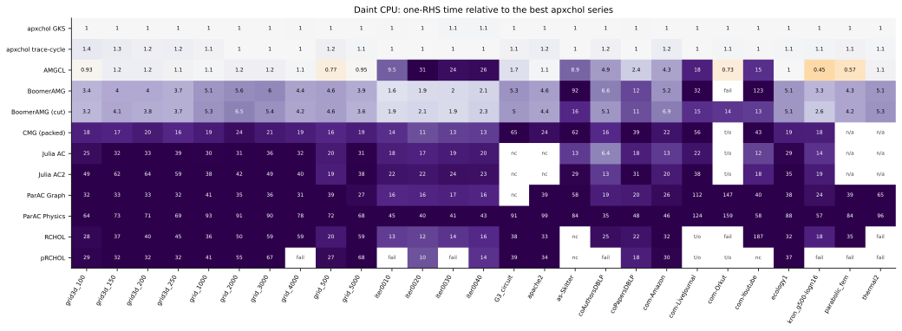
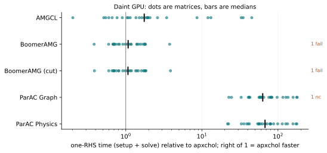
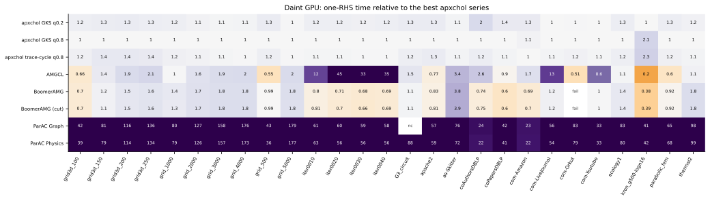

# Daint: ARM64 Grace and CUDA

CSCS Daint GH200: 72-core NVIDIA Grace CPU and Hopper GPU. These are the
ARM CPU results. All 540 planned cells (27 matrices × 20 solver
configurations) were run, and 507 of them met the 1e-8 tolerance.

Each chart shows one-RHS time (setup plus solve) relative to the fastest
apxchol configuration on the same matrix and device. Values above 1 mean
apxchol was faster. Cells that did not produce a valid result are labelled:
`fail` (failed), `nc` (did not converge), `t/o` (timed out) and `n/a`
(input not supported).

```{note}
These results were recorded in September 2026, under older benchmark rules:
competitors had no time cap relative to apxchol. ParAC used its own stopping rule, residual and right-hand side.
apxchol GPU series used degree quantile 0.8 or 0.2; the current default is 0.5.
```

## ARM CPU

72 threads.




## CUDA





## Provenance

[Download all cells](performance/daint-20260910.json), converted from the
published [results table](https://github.com/AlgOptGroup/apxchol/blob/390467c0dcb665a531ef5ab6bf53e2e895646900/benchmarks/daint/results.csv).
Each cell records its source revision, toolchain and, where it was recorded,
the binary checksum.
