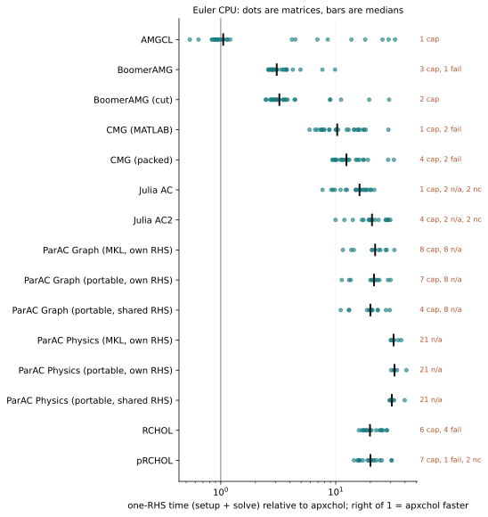
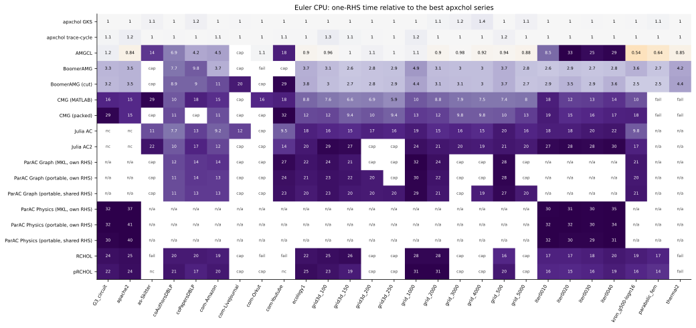
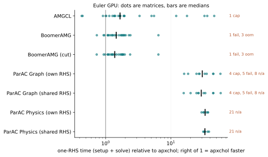
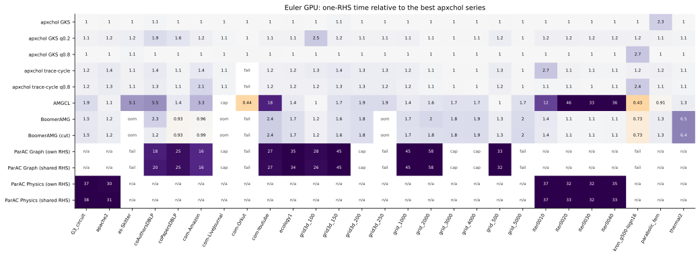

# Euler: x86_64 and CUDA

ETH Euler `eu-g6` node: 2 × AMD EPYC 9554 (64 cores each) and 8 × NVIDIA
RTX 4090 (24 GB). CPU series use 64 threads on one socket; CMG is serial.
The campaign planned 783 cells (27 matrices × 29 solver configurations), and
all of them ran: 541 met the 1e-8 tolerance on the original system.

Each chart shows one-RHS time (setup plus solve) relative to the fastest
apxchol configuration on the same matrix and device. Values above 1 mean
apxchol was faster. Cells without a valid result are labelled:
`cap` (exceeded the time cap), `fail` (failed), `oom` (out of memory),
`nc` (did not converge) and `n/a` (input not supported).

Competitors are capped at 20 times the best apxchol total on the same matrix
and device, and at least 30 s. A run over the cap is shown as `cap`, not as a
time.

```{note}
ParAC runs in two ways. "Own RHS" uses ParAC's own zero-sum right-hand side,
as on Daint; "shared RHS" uses the campaign's common right-hand side. Most
`n/a` cells are ParAC: its physics mode grounds a singular Laplacian by
dropping a row, and its graph mode cannot solve a disconnected graph with a
single zero-sum right-hand side.
```

## CPU





## CUDA

The GPU apxchol series use the default degree quantile 0.5, plus 0.8 and 0.2
for comparison with Daint.





## Provenance

[Download all cells](performance/euler-20261031.json): apxchol revision
`1c4abb35`, toolchains, binary and matrix checksums, the reason for every
cell without a result, and a thread-scaling series (1 to 128 threads) on
three matrices. GPU memory is not published: these runs recorded device-wide
usage, not per-process usage.
