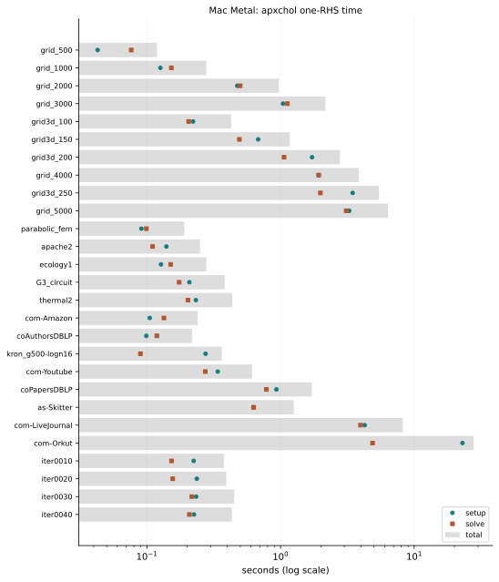

# Apple M1 Max: CPU and Metal

Apple M1 Max: 8 performance and 2 efficiency cores, a 32-core GPU and 32 GB
unified memory, on macOS 26.0.1. The CPU runs use the 8 performance cores.
macOS can't pin threads, so runs were unpinned, and processes ran at lower
priority on a shared machine.

No other solver in the comparison has a Metal backend, so the Metal section
shows apxchol's own times. The CPU section compares apxchol with the other
solvers, including Apple's Accelerate sparse Cholesky.

## CPU

Competitors ran on the 21 matrices that fit comfortably in 32 GB, and their
cells on the other six are `n/a`. On the 21, `n/a` means the solver does not
accept that input. apxchol ran on all 27. Competitors are capped at 20 times the
fastest complete apxchol setup + solve time on the same matrix, and at least
30 s.


On this CPU, AMGCL is faster than apxchol on 12 of 21 matrices, including
every grid. On linear programs, AMGCL is 1.8× faster on iter0010, and
BoomerAMG is within 6% of apxchol on the other three. apxchol is ahead on five
of the six social graphs.

An asterisk (`*`) marks a time whose setup includes input adaptation by the
benchmark: finding connected components, pinning one vertex per component or
slicing components, so that the solver accepts a singular or disconnected
Laplacian. The `adapt_s` column of the data files gives that part of setup.


```{note}
Accelerate is a direct sparse Cholesky factorization (`SparseFactor`) with
refinement on the original system; it reports one iteration per solve. Its
`oom` cells were stopped before factorization, when the predicted factor did
not fit in half of the memory. RCHOL and pRCHOL use a portable PCG and run
without thread pinning. ParAC uses its portable CPU solve and its own
right-hand side. CMG is the serial native port; MATLAB is not available here.
```


```{include} performance/mac-cpu-agreement.md
```

```{include} performance/mac-cpu-times.md
```

## Metal



All 27 matrices met the 1e-8 tolerance on the original system, including
com-Orkut (237 million stored nonzeros) within the 32 GB of unified memory.
Times come from the repeat with the median setup + solve time, out of three
after one warm-up. Peak memory is the whole process.

```{include} performance/mac-metal-table.md
```

## Provenance

[Every result](performance/mac-20261114.csv) and
[what all results share](performance/mac-20261114.json): hardware, toolchains,
revisions and the cap rule. All runs used apxchol revision `7dee3a3a`. The
header points to the full extract with binary and matrix checksums.
