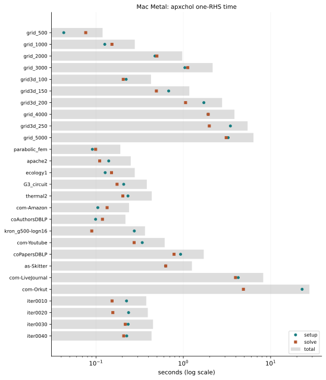

# Apple M1 Max: Metal

Apple M1 Max: 8 performance and 2 efficiency cores, a 32-core GPU and 32 GB
unified memory, on macOS 26.0.1. Metal is the route measured here; for ARM CPU
results, see [Daint](performance-daint.md).

No other solver in the comparison has a Metal backend, so this page shows
apxchol's own times. All 27 matrices met the 1e-8 tolerance on the original
system, including com-Orkut (237 million stored nonzeros) within the 32 GB of
unified memory.

```{note}
These results were measured at revision `0009d670`, from the pull request
that added the benchmark's Metal route. Host code used the 8 performance cores; macOS can't
pin threads, so runs were unpinned.
```

## Metal



Times come from the repeat with the median setup + solve time, out of three after one warm-up. Peak memory is the
whole process.

```{include} performance/mac-metal-table.md
```

## Provenance

[Download all cells](performance/mac-20261031.json): hardware, toolchain,
benchmark binary checksum, matrix checksums and the largest residual over the repeats.
