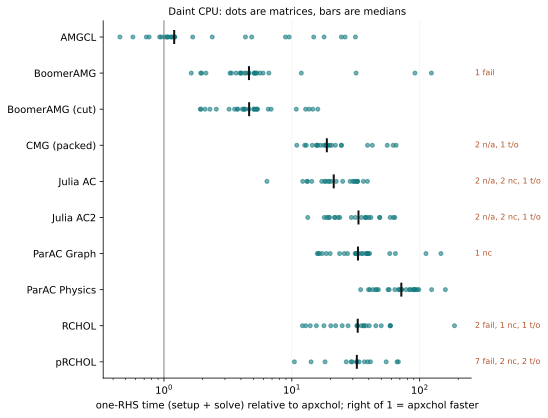

# Performance

This page compares apxchol with other Laplacian and SDDM solvers on the same
matrices, right-hand sides and stopping rule. Each platform page lists every
measured cell, including failures.

```{toctree}
:hidden:

Euler (x86_64 + CUDA) <performance-euler>
Daint (ARM64 + CUDA) <performance-daint>
Apple M1 Max (Metal) <performance-mac>
```

| Platform | Hardware | Routes |
|---|---|---|
| [Euler](performance-euler.md) | 2 × AMD EPYC 9554, 8 × RTX 4090 | CPU, CUDA |
| [Daint](performance-daint.md) | NVIDIA GH200 (72-core Grace, Hopper) | ARM CPU, CUDA |
| [Apple M1 Max](performance-mac.md) | M1 Max, 32 GB unified memory | Metal |

## Headline results

```{note}
The comparison charts show one-RHS time (setup plus solve) for each competitor relative
to apxchol: dots are matrices, bars are medians, and values above 1 mean
apxchol was faster. Euler results for 1.0 are being measured.
```

- **x86_64 CPU (Euler):** chart pending.
- **CUDA (Euler):** chart pending.

### ARM64 CPU (Daint)



Recorded in September 2026 under older benchmark rules; see the [Daint page](performance-daint.md) for every
cell and the differences.

### Metal (Apple M1 Max)

No other solver here has a Metal backend, so this chart shows apxchol's own
one-RHS time on each matrix. All 27 met the tolerance; see the
[Apple M1 Max page](performance-mac.md) for the table.


## How results are measured

Every solver gets the same matrix and right-hand side. A result counts only if
the residual of the original system meets the
tolerance of 1e-8. Setup and solve are timed separately. A solver that fails,
runs out of memory or exceeds its time cap is shown with that status, not
dropped. The [measurement contract](../benchmarks/README.md#measurement-contract)
gives the details. To run the comparison on your own hardware, use the
[benchmark harness](../benchmarks/README.md).

For batched and repeated solves, see the
[batching case study](batching.md#larger-graph-youtube).
