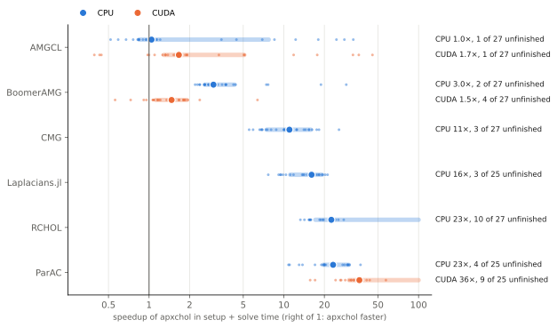

# Performance

These results compare apxchol with other Laplacian and SDDM solvers on 27
matrices, using the same matrix, right-hand side and stopping rule for every
solver. Times are setup + solve for one right-hand side. Each platform page
lists every measured result, including failures.

```{toctree}
:hidden:

Euler (x86_64 + CUDA) <performance-euler>
Daint (ARM64 + CUDA) <performance-daint>
Apple M1 Max (CPU + Metal) <performance-mac>
```

| Platform | Hardware | Routes |
|---|---|---|
| [Euler](performance-euler.md) | 2 × AMD EPYC 9554, 8 × RTX 4090 | CPU, CUDA |
| [Daint](performance-daint.md) | NVIDIA GH200 (72-core Grace, Hopper) | ARM CPU, CUDA |
| [Apple M1 Max](performance-mac.md) | M1 Max, 32 GB unified memory | ARM CPU, Metal |

## Speedup over each solver family



apxchol is faster than every other solver family except AMGCL on the CPU,
where the median is a draw. On the RTX 4090 it is a median 1.7× faster than
AMGCL and 1.5× faster than BoomerAMG.

Each small dot is one matrix: the setup + solve time of the family's fastest
variant on that matrix, divided by apxchol's. The large dot is the median and
the band covers the middle half. A run that failed, ran out of memory or
exceeded its time cap counts as an apxchol win; the labels say how many there
were. apxchol runs its default configuration.

## Where apxchol wins


Multigrid, usually AMGCL, is as fast or faster on grids and meshes. apxchol
wins on linear programs and social graphs. Against the fastest other solver on
each matrix, apxchol is faster on 16 of 27 matrices on the CPU and on 20 of 27
on the GPU.

## Every matrix

Each cell is the speedup of apxchol over the family's fastest variant on that
matrix. `≥20×` means the solver exceeded its time cap of 20 times apxchol's
time; `fail`, `oom` and `nc` mean it failed, ran out of memory or did not
converge; `n/a` means it does not accept that input. The
[Euler page](performance-euler.md) breaks each family into its variants.

### CPU


### CUDA


## How results are measured

Every solver gets the same matrix and right-hand side. A result counts only if
the residual of the original system meets the tolerance of 1e-8. Setup and
solve are timed separately, and the charts use their sum. A solver that fails,
runs out of memory or exceeds its time cap is shown with that status, not
dropped. The [measurement contract](../benchmarks/README.md#measurement-contract)
gives the details. To run the comparison on your own hardware, use the
[benchmark harness](../benchmarks/README.md).

For batched and repeated solves, see the
[batching case study](batching.md#larger-graph-youtube).
