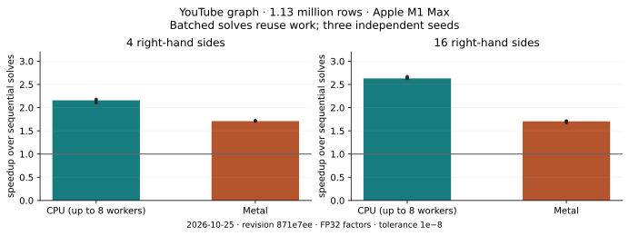

# Performance

Two kinds of measurements are shown here: short checks run with each `main`
commit, and a dated comparison on a larger public graph. Neither is a universal
ranking of solvers or hardware.

## Current CPU and Metal measurements

```{include} performance/latest.md
:heading-offset: 2
```

The short suite calls the Python API on 192×192 and 512×512 five-point grid
operators, with RHSs formed as `A` times seeded Gaussian vectors. It compares CPU worker ceilings of one and two; the macOS run also
requests Metal explicitly. A missing GPU or a failed residual check fails the
job instead of substituting another backend.

Each configuration runs in a fresh process for three fixed seeds, with a second
identical run as a control. Dots show every observation. Hatched bars mean at
least one of the available timing metrics differed by more than 10% between its paired controls: those
results describe the run but do not establish a performance difference.

“Setup + one solve” includes factor construction and the first scalar solve.
The SciPy baseline is conjugate gradients **without a preconditioner**, using
the same matrix, RHS, tolerance and iteration budget. It is a simple reference,
not a comparison with tuned AMG or sparse direct solvers. A SciPy result that
misses tolerance is marked as nonconverged and omitted from the timing plot;
apxchol's checks are reported separately.

The batching panel compares one four-column call with four sequential scalar
calls using the same prepared solver and RHS columns. It measures reuse after
the first four-column solve has allocated workspace. Setup and first-call times
are included separately in the downloadable records.

apxchol uses FP32 factor storage. Both solvers use tolerance `1e-8` and at most
2,000 iterations.
Every returned column is checked against the original system outside the timer;
the solver's own final verification remains inside it. NumPy's BLAS work is
limited to one thread. Builds and other tests finish before measurements begin.

To repeat the short suite after installing this checkout, run
`python benchmarks/docs_benchmark.py build/performance/local.json` with the
thread limits above. Add `--metal` on a Mac with a Metal build.

## Larger graph: YouTube



This comparison uses the unweighted Laplacian of
[SNAP/com-Youtube](https://sparse.tamu.edu/SNAP/com-Youtube): 1,134,890 rows and
7,110,138 stored entries. It ran on an Apple M1 Max with a ceiling of eight CPU
workers, FP32 factor storage and tolerance `1e-8`. RHSs were normalized `L*x`
vectors from seeded random `x`.

CPU and Metal settings were chosen separately before three held-out seeds were
measured. Both selected degree quantile `0.2`. Each plotted point is the ratio
between sequential scalar calls and one matrix call at the same width, reusing
that route's factor. The bar shows the median of the three points.

| Median time | CPU | Metal |
|---|---:|---:|
| Setup + first scalar solve | 0.614 s | 0.617 s |
| First scalar solve | 0.214 s | 0.240 s |
| Reused four-column solve | 0.397 s | 0.512 s |
| Reused sixteen-column solve | 1.284 s | 2.054 s |

There was no consistent setup-plus-one winner across these seeds. Batching
helped both routes, while CPU finished the four- and sixteen-column solves
sooner on this graph.

All three YouTube blocks passed the preregistered 5% control-variation gate and
all 768 RHS checks passed. The full campaign also included Amazon and Grid5000;
only zero and one of their three blocks passed that gate, respectively. They
are omitted from the charts rather than presented as reliable speedups.

Measured on **2026-10-25**, at
[revision `871e7ee`](https://github.com/AlgOptGroup/apxchol/commit/871e7eeedfc70d51f3ea7fa043a5f7ca6eddeeb0).
[Download timings, settings and provenance](performance/youtube-20261025.json).
These are native C++ API timings; the small hosted suite measures Python calls.

See [benchmarking and reproducibility](../benchmarks/README.md) for the timing
contract and larger comparisons.
